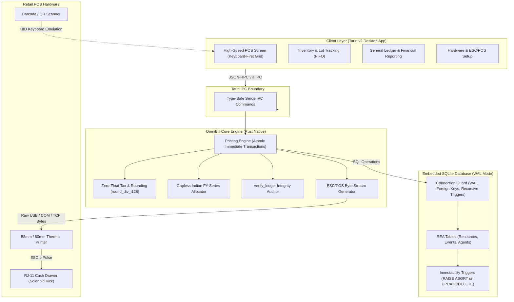

# OmniBill ERP

[](https://github.com/killind0d0/omnibill/actions/workflows/build-release.yml)
[](https://github.com/killind0d0/omnibill/releases)
[](https://www.rust-lang.org/)
[](https://tauri.app/)
[](https://www.sqlite.org/)
[](LICENSE)
[](https://github.com/killind0d0/omnibill)

> **High-Performance, Zero-Float, Offline-First Desktop ERP & POS for Indian Retail, Wholesale, and Distribution.**

---

## 📌 Executive Overview

**OmniBill ERP** is an ultra-fast, offline-first billing, inventory, and accounting system engineered specifically to resolve the chronic pain points of Indian retail, wholesale, pharmacy, and FMCG businesses. Built on **Rust**, **SQLite WAL**, and **Tauri v2**, OmniBill replaces bloated Electron wrappers and fragile web billing apps with a standalone native binary under **15 MB** that starts in under **50 ms** and executes transactions with sub-millisecond local latency.

Traditional retail solutions in India (such as *Vyapar*, *myBillBook*, or legacy *Tally*) suffer from IEEE-754 floating-point rounding errors, cloud-sync stalls during peak rush hours, vulnerability to silent database edits, and slow browser-mediated printing dialogues. OmniBill is architected from the ground up on the **Resource-Event-Agent (REA)** accounting model, using strict integer-only arithmetic, database-engine-level immutability triggers, and direct raw byte hardware control for thermal receipt printers.

---

## ⚡ Core Advantages over Legacy Systems

| Capability | Legacy Systems (*Vyapar*, *myBillBook*, *Tally*) | OmniBill ERP |
| :--- | :--- | :--- |
| **Arithmetic Engine** | Double-precision floats (`Number`, `f64`), subject to rounding drift (`0.1 + 0.2 = 0.30000000000000004`) | **Strict Integer-Only Representation** (`i64` Paise, Milli-units, Basis Points) with half-away-from-zero rounding. Zero float drift. |
| **Audit & Immutability** | Mutable tables, soft deletes, or editable historical vouchers allowing silent tampering | **Trigger-Enforced Immutability** at the SQLite C-engine layer. `UPDATE` and `DELETE` on posted entries trigger unconditional SQL aborts. |
| **Network Dependency** | Cloud-tethered or browser-based; stalls or spins during internet drops or high-traffic sync | **100% Offline-First**. Local SQLite WAL database. Zero network hops required for billing, stock reservation, or receipt generation. |
| **Hardware Printing** | Browser `window.print()` dialog; takes 3–5 seconds, alters layout, cannot kick cash drawers | **Direct ESC/POS Raw Byte Pipeline**. Instant thermal printing (<100ms) over USB/Serial/Network with hardware drawer pulses & dynamic UPI QR. |
| **Binary Size & Memory** | Electron/Chromium runtime: 150 MB–300 MB installer, 400 MB–800 MB idle RAM consumption | **Lean Native Desktop App**: <15 MB standalone installer, <40 MB RAM footprint, optimized for modest counter hardware. |
| **Sequential Series** | Soft sequence generators subject to race conditions and gaps during network retries | **Gapless GST Sequence Allocator** with SQLite triggers enforcing strictly consecutive progression (`next_number = OLD.next_number + 1`). |

### 1. Zero-Float Arithmetic Engine
Accounting discrepancies of even 1 paisa (₹0.01) cause GST reconciliation rejections during GSTR-1 and GSTR-3B filings. JavaScript and Python numbers use IEEE-754 binary floating-point representation, which cannot accurately represent decimal fractions like 0.1 or 0.05. 

OmniBill eliminates floating-point arithmetic entirely from the schema, domain layer, and calculation engine:
* **Currency**: Represented as `i64` in **Paise** (₹1.00 = `100` paise).
* **Quantities**: Represented as `i64` in **Milli-units** (`1.000` kg = `1000` milli-units).
* **Tax Rates**: Represented as `i64` in **Basis Points** (`18.00%` = `1800` bps).
* **Checked Math**: All tax and line item calculations use 128-bit checked math (`round_div_i128`) with round-half-up (away from zero) mechanics, preventing arithmetic overflows or bit-level deviations.

### 2. Trigger-Enforced Immutability
In retail and corporate accounting, an invoice is a legal contract. OmniBill enforces audit durability directly inside the SQLite database engine using SQLite triggers:
* `ledger_entries`, `stock_movements`, `transaction_items`, `payments`, and `payment_allocations` forbid `UPDATE` and `DELETE` operations via `RAISE(ABORT, 'IMMUTABILITY_RULE_BROKEN')`.
* On `transactions`, updates are restricted to transitioning `POSTED -> CANCELLED` only, provided that all financial, tax, and relational columns remain bit-for-bit identical (`OLD.col IS NEW.col`).
* Even if an administrator opens the SQLite database file in an external GUI or tool, the database engine itself rejects unauthorized tampering.

### 3. Offline-First Resilience
Counter staff cannot afford billing delays during weekend rush hours due to internet throttling or cloud server latency. OmniBill operates completely locally with SQLite in **Write-Ahead Logging (WAL)** mode. Reads and writes never block each other:
* Checkouts commit to disk in less than **1 ms**.
* Full ACID crash durability is maintained with `PRAGMA synchronous = FULL`.
* The system is unaffected by external cloud outages, DDoS attacks, or ISP downtimes.

### 4. Direct ESC/POS Hardware Printing
Instead of delegating print jobs to OS print spoolers and web view dialogue boxes:
* OmniBill synthesizes raw ESC/POS byte sequences directly in Rust.
* Transmits raw control bytes straight to thermal receipt printers (58 mm / 80 mm) via USB Bulk Transfer, Serial RS-232/Virtual COM, or Raw TCP Socket (`9100`).
* Generates on-the-fly raster UPI Dynamic QR codes encoding the NPCI spec (`upi://pay?pa=...&pn=...&am=...&tr=...`) for instant contactless customer checkout.
* Sends hardware pulse signals (`ESC p`) to automatically eject standard cash drawers upon tender completion.

---

## ⌨️ POS Keyboard Shortcuts Cheat Sheet

OmniBill is engineered for **heads-down, high-throughput retail cashier operation**. Every key retail action can be accomplished entirely from the keyboard without touching a mouse.

| Shortcut | Action | Description |
| :--- | :--- | :--- |
| **`F1`** | **Help / Shortcuts** | Displays the interactive keyboard navigation overlay and user guide. |
| **`F2`** | **New Sale Invoice** | Resets active counter screen and initializes a new sales invoice. |
| **`F3`** | **Customer Search** | Focuses customer phone/name/GSTIN search modal (defaults to Walk-in). |
| **`F4`** | **Product / SKU Search** | Focuses the item search bar or activates barcode scanner input buffer. |
| **`F5`** | **Tender / Payment Modal**| Opens payment settlement screen (Cash, UPI, Card, Bank Transfer, Split). |
| **`F6`** | **Hold / Park Bill** | Parks the current uncommitted cart so another customer can be served. |
| **`F7`** | **Recall Parked Bill** | Opens the list of held bills to restore and complete checkout. |
| **`F8`** | **Purchase Inward** | Switches to Purchase Inward mode for vendor delivery recording. |
| **`F9`** | **Returns / Credit Note** | Opens Credit Note / Sales Return workflow against original invoice ID. |
| **`Alt + S`** | **Quick Save & Print** | Instantly finalizes transaction, allocates gapless invoice number, and fires ESC/POS print. |
| **`Alt + C`** | **Exact Cash Tender** | Automatically tenders exact invoice total in Cash, posts ledger, and cuts receipt. |
| **`Alt + U`** | **Generate Dynamic UPI** | Displays dynamic UPI payment QR on customer-facing display and prints on thermal bill. |
| **`Enter`** | **Confirm / Next Line** | Commits current line item row and moves cursor to next item entry. |
| **`Esc`** | **Cancel / Back** | Dismisses active modal dialog or clears current line item selection. |
| **`F10`** | **Day-End Z-Report** | Compiles register closing summary, total cash in drawer, and daily tax breakdown. |

---

## 🏗️ System Architecture



---

## 🚀 Quickstart Guide

### Prerequisites
* **Rust Toolchain**: Stable Rust 2024 (1.85+ recommended). Install via [rustup.rs](https://rustup.rs/).
* **Node.js**: v18.0.0 or higher (v20+ recommended).
* **C++ Compiler**:
  * **Windows**: Visual Studio C++ Build Tools 2022 (Desktop C++ workload).
  * **Linux**: `build-essential`, `libwebkit2gtk-4.1-dev`, `libssl-dev`.
  * **macOS**: Xcode Command Line Tools (`xcode-select --install`).

### 1. Clone & Setup
```bash
git clone https://github.com/killind0d0/omnibill.git
cd omnibill
```

### 2. Run Comprehensive Test Suite
OmniBill includes 58+ unit and integration tests covering database triggers, integer math, ledger verification, and posting workflows:
```bash
# Run tests via npm
npm test

# Or run tests directly via cargo
cargo test --manifest-path src-tauri/Cargo.toml
```

### 3. Run in Development Mode
Launch the native desktop application with hot-reloading:
```bash
npm run dev
# Or: npm run tauri dev
```

### 4. Build Production Standalone Bundle
Build the optimized standalone binary (<15 MB):
```bash
npm run build
# Or: npm run tauri build
```
Production installers will be located in:
* **Windows**: `src-tauri/target/release/bundle/msi/*.msi` and `bundle/nsis/*.exe`
* **Linux**: `src-tauri/target/release/bundle/deb/*.deb` and `bundle/appimage/*.AppImage`
* **macOS**: `src-tauri/target/release/bundle/dmg/*.dmg`

---

## 📚 Technical Documentation

For deeper architectural concepts, schema definitions, and platform setup instructions, see:
* [**ARCHITECTURE.md**](file:///home/killindodo/omnibill/ARCHITECTURE.md) – Deep dive into REA accounting, integer math invariants, SQLite triggers, and the ESC/POS printer pipeline.
* [**SETUP.md**](file:///home/killindodo/omnibill/SETUP.md) – Step-by-step developer environment setup for Windows, Linux, and macOS.

---

## 📄 License
This project is licensed under the MIT License. See [LICENSE](LICENSE) for details.
